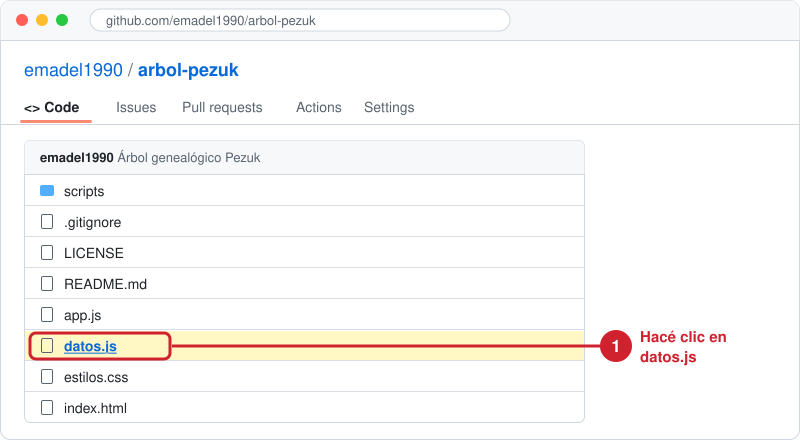
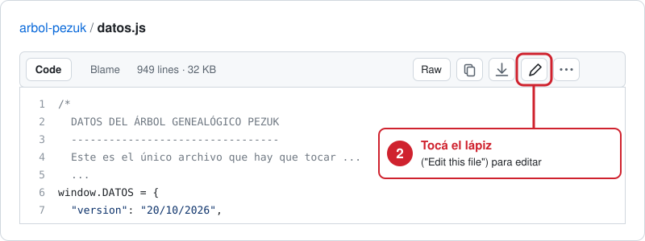
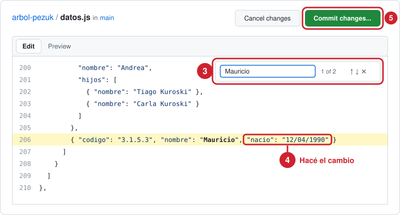
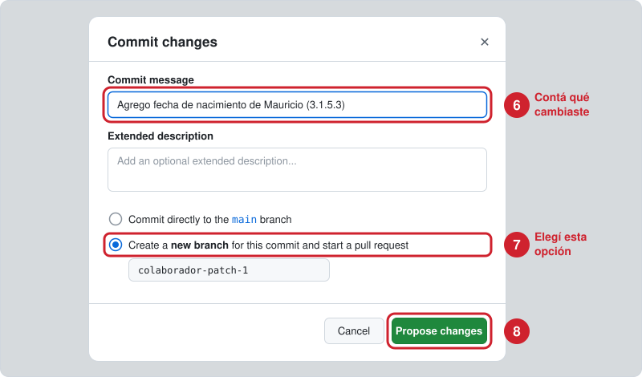
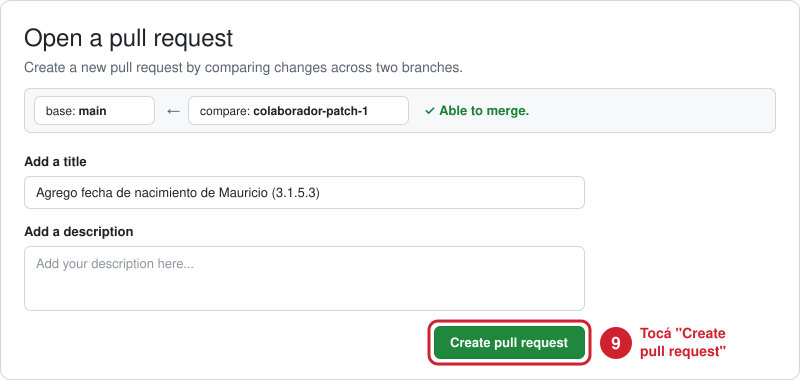
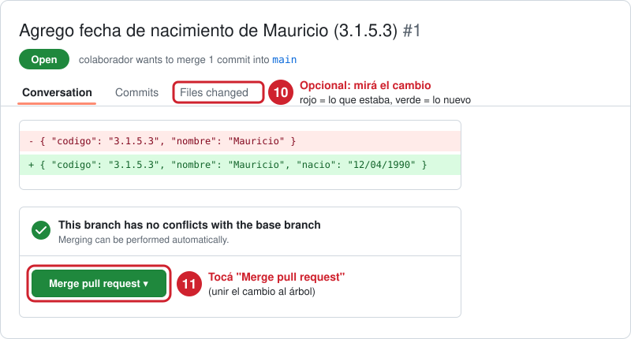
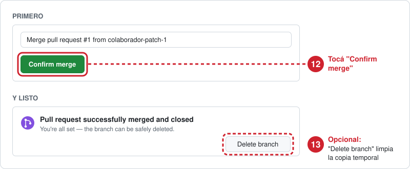

# Árbol Genealógico Pezuk

## Cómo corregir el árbol desde GitHub, paso a paso

Esta guía es para quien ayuda a mantener el árbol al día. No hace falta instalar nada ni saber programar: todo se hace desde el navegador, en la página de GitHub.

> **Las imágenes son ilustraciones.** GitHub cambia su diseño cada tanto, así que lo que veas puede ser un poco distinto. Los botones tienen el mismo nombre (GitHub está en inglés, por eso los nombres de los botones aparecen en inglés).

### Antes de empezar (solo la primera vez)

1. Necesitás una cuenta de GitHub. Si no tenés, creala gratis en [github.com/signup](https://github.com/signup).
2. Te va a llegar un correo de GitHub con una **invitación para colaborar** en `arbol-pezuk`. Abrilo y tocá **"Accept invitation"**. Sin ese paso no vas a poder guardar cambios.

### La idea general

Vas a hacer tres cosas:

1. **Editar** el archivo `datos.js`, que es donde están todas las personas del árbol.
2. **Proponer** el cambio. GitHub lo guarda aparte, como un borrador, y lo llama _pull request_.
3. **Unir** ese borrador al árbol (_merge_). Recién ahí el cambio aparece en la página.

Hacerlo en dos pasos sirve para revisar el cambio antes de que lo vea toda la familia, y si algo sale mal se puede volver atrás.

### Paso 1: abrir el archivo de datos

Entrá a [github.com/emadel1990/arbol-pezuk](https://github.com/emadel1990/arbol-pezuk) y hacé clic en **`datos.js`**.



### Paso 2: entrar a editar

Arriba a la derecha del archivo hay un **lápiz** (si pasás el mouse dice "Edit this file"). Tocalo.



### Paso 3: buscar a la persona y hacer el cambio



- **(3)** Para buscar, hacé clic adentro del texto y apretá **Ctrl + F** (en Mac, **Cmd + F**). Escribí el nombre o el código de la persona, por ejemplo `Mauricio` o `3.1.5.3`. Con las flechas pasás de un resultado al siguiente.
- **(4)** Hacé el cambio. Por ejemplo, para agregar la fecha de nacimiento de Mauricio:

  Antes:

  ```js
  { "codigo": "3.1.5.3", "nombre": "Mauricio" }
  ```

  Después:

  ```js
  { "codigo": "3.1.5.3", "nombre": "Mauricio", "nacio": "12/04/1990" }
  ```

- Cambiá también la fecha de `"version"` (está casi al principio del archivo) por la fecha de hoy. Esa fecha aparece arriba en la página, así la familia sabe que hay novedades.
- **(5)** Cuando termines, tocá el botón verde **"Commit changes..."**.

**Tres reglas para no romper la página:**

- Los textos van siempre **entre comillas dobles**: `"así"`.
- Entre un dato y el siguiente va **una coma**. Después del último dato de la persona, no.
- Cada persona va entre llaves `{ }`. Si agregás un hijo, copiá a un hermano como modelo y cambiale los datos.

Más abajo, en [Cómo editar los datos de la familia](#cómo-editar-los-datos-de-la-familia), está la lista de todos los datos que se pueden cargar.

### Paso 4: proponer el cambio

Se abre una ventanita:



- **(6)** En **"Commit message"** escribí en pocas palabras qué cambiaste. Por ejemplo: _Agrego fecha de nacimiento de Mauricio (3.1.5.3)_.
- **(7)** Elegí la segunda opción: **"Create a new branch for this commit and start a pull request"**. El nombre que aparece abajo (algo como `tu-usuario-patch-1`) dejalo como está.
- **(8)** Tocá **"Propose changes"**.

### Paso 5: crear el pull request

Vas a ver la página "Open a pull request". El título ya viene completo con tu mensaje.



- **(9)** Tocá **"Create pull request"**.

### Paso 6: revisar y unir el cambio



- **(10)** Opcional, pero recomendado: en la pestaña **"Files changed"** ves exactamente qué cambió. En **rojo** lo que estaba antes, en **verde** lo nuevo. Fijate que sea lo que querías.
- **(11)** Volvé a la pestaña **"Conversation"** y tocá **"Merge pull request"**.

### Paso 7: confirmar



- **(12)** Tocá **"Confirm merge"**.
- Vas a ver un cartel violeta que dice **"Merged"**. ¡Listo!
- **(13)** Opcional: tocá **"Delete branch"** para borrar el borrador, que ya no hace falta. El cambio no se pierde.

En unos minutos la página del árbol se actualiza sola. Si no ves el cambio, recargá la página.

### Si algo sale mal

- **Te arrepentiste antes de unir:** en el pull request, abajo de todo, tocá **"Close pull request"**. No se cambia nada.
- **Aparece un cartel que dice "conflicts" o el botón de unir está gris:** no lo fuerces. Avisale a Mauricio con el link del pull request.
- **Ya uniste y la página se ve rota o vacía:** seguramente falta una coma o unas comillas. No pasa nada, todo queda guardado en el historial y se puede volver atrás. Avisale a Mauricio.

---

## Parte técnica

Un árbol genealógico en letra grande y fácil de usar en el celular para la familia Pezuk, descendientes de Miguel Pezuk y Maria Zsavaga. Reemplaza al PDF gigante que se exportaba desde Excel.

Es un sitio estático simple. No hay paso de compilación, ni framework, ni dependencias.

## Archivos

| Archivo               | Qué es                                                                                             |
| --------------------- | -------------------------------------------------------------------------------------------------- |
| `datos.js`            | **Todos los datos de la familia.** Es el único archivo que tenés que editar para cambiar personas. |
| `index.html`          | Estructura de la página y textos fijos (instrucciones, títulos, pie de página).                    |
| `estilos.css`         | Aspecto visual y diseño para imprimir.                                                             |
| `app.js`              | Dibujado del árbol, búsqueda, tamaño de letra y el botón "Corregir".                               |
| `scripts/validar.mjs` | Revisa `datos.js` para encontrar errores antes de publicar.                                        |

## Cómo editar los datos de la familia

Abrí `datos.js`. Cada persona se ve así, y solo `nombre` es obligatorio:

```js
{ "codigo": "3.1.5.3", "nombre": "Mauricio", "pareja": "Nombre Apellido",
  "nacio": "12/04/1990", "fallecio": "", "notas": "Alguna nota",
  "hijos": [ /* hijos, con la misma forma */ ] }
```

| Campo                              | Significado                                                                                                                                |
| ---------------------------------- | ------------------------------------------------------------------------------------------------------------------------------------------ |
| `codigo`                           | El código familiar. El código de un hijo empieza con el código del padre o la madre: los hijos de `3.1.5` son `3.1.5.1`, `3.1.5.2`, y así. |
| `nombre`                           | Nombre del descendiente.                                                                                                                   |
| `pareja`                           | Esposo, esposa o pareja. Usá `"? (nombre desconocido)"` cuando no se sabe.                                                                 |
| `nacio` / `fallecio`               | Fechas de nacimiento y fallecimiento como texto libre, por ejemplo `"1904"` o `"23/07/2013"`.                                              |
| `pareja_nacio` / `pareja_fallecio` | Las fechas de la pareja.                                                                                                                   |
| `notas`                            | Una nota que aparece debajo del nombre. Puede ser un texto o una lista de textos.                                                          |
| `hijos`                            | Una lista de hijos. Si no tiene, no lo pongas.                                                                                             |

Algunas ediciones comunes:

- **Agregar un hijo.** Buscá al padre o la madre, agregá una lista `"hijos": [ ... ]` si no la tiene, y poné a la persona nueva adentro.
- **Corregir una fecha o un nombre.** Cambiá el texto entre comillas.
- **Nueva versión.** Actualizá `"version"` al principio con la fecha de hoy. Aparece en el encabezado de la página.

La búsqueda, la cantidad de personas por rama y la línea de parentesco ("hijo de Ruben, nieto de Juan...") salen de los datos, así que no hace falta actualizar nada más.

Después de editar, corré el verificador. Necesita Node, que ya está instalado en esta Mac:

```bash
node scripts/validar.mjs
```

Avisa si faltan comas, si hay códigos repetidos o códigos que no coinciden con el de su padre o madre.

## Cómo verlo en tu computadora

Abrí `index.html` directamente en el navegador, o levantá un servidor en la carpeta:

```bash
python3 -m http.server 8000
```

Después entrá a http://localhost:8000.

## Cómo publicarlo

Sirve cualquier hosting estático. Publicá la raíz del repositorio tal como está.

- **Vercel.** Importá el repo, elegí el preset de framework "Other" y dejá vacío el comando de build.
- **Netlify.** Usá la misma configuración, con el directorio de publicación en `.`.
- **GitHub Pages.** Publicá desde la rama `main`, carpeta raíz.

Mantené siempre la misma dirección. La idea es que los parientes tengan un solo link que siempre muestre la última versión, en vez de PDFs viejos reenviados.

## Cómo imprimir

La página tiene un diseño para imprimir. Abrí `https://emadel1990.github.io/arbol-pezuk/#imprimir` para desplegar todas las ramas, y después imprimí o guardá como PDF desde el navegador.

## Quién puede editar

Los visitantes solo pueden ver. Las correcciones le llegan a Mauricio por el botón "Corregir", que arma un mensaje de WhatsApp o de correo con el código de la persona. Solo quienes tienen permiso de push en este repositorio pueden cambiar el árbol.

El link de WhatsApp da por hecho que es un celular argentino (`+54 9` más el número que está en `datos.js`). Si el número cambia, editá `contacto` en `datos.js`. Si no es un celular, ajustá la línea `wa` en `app.js`.
